<p align="center">
  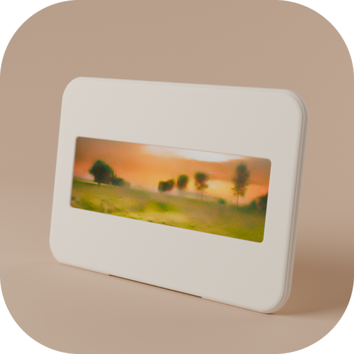
</p>

<h1 align="center">Kinn</h1>

<p align="center">
  Grandma tells a story in Spanish. Her grandson hears it in English, in her own voice, and watches it come alive.
</p>

<p align="center">
  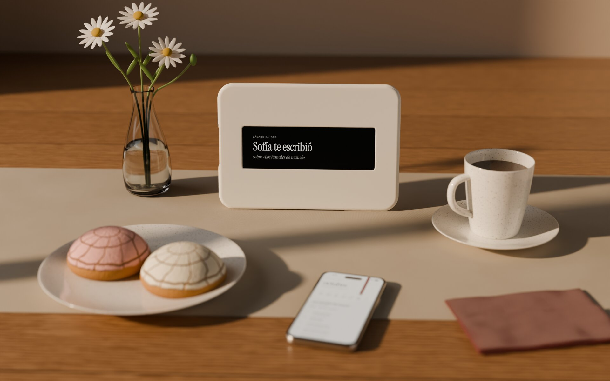
</p>

<p align="center">
  <a href="https://mothertongue-hearth.netlify.app/?demo=1">Try the Hearth demo</a>
  <!-- demo video link -->
  · Demo video: coming soon
</p>

<p align="center">
  <sub>Built in 24 hours at HackTX 2026 for the Meta track, Bringing people closer together with AI.</sub>
</p>

> **TL;DR**\
> A framed screen for a grandparent's kitchen and an iPhone app for the grandchild.\
> For families where the grandparents speak one language and the grandkids another.\
> AI translates what each of them says, speaks it in the speaker's own voice, and turns her stories into short films.\
> You can [try the Hearth in your browser](https://mothertongue-hearth.netlify.app/?demo=1) now, no account needed.

Margaret lives in Monterrey. Her grandson Angel lives in Austin, and the
Spanish Angel has is mostly "te quiero". They love each other and they cannot
really talk.

One morning Margaret sits at her kitchen table and taps the frame on the shelf.
There is nothing to press and nothing to set up. She tells the story of
Christmas when she was a girl: her mother waking her and her sister Lupe at
five, the kitchen dark and smelling of firewood, the yellow bulb over the
table, "ándale, que la masa no espera". The two girls sat on the floor with
the husks in their laps, still damp and warm, and spread the masa thin with
the back of a spoon. Her mother sang very low so their father would keep
sleeping. "Y ya no hay nadie a quien despertar, mijo."

An hour later Angel opens his phone in Austin. He hears the story in English,
in his grandmother's own voice, while the kitchen at dawn fades in scene by
scene. He listens twice. Then he holds the button and asks: will you teach
me this Christmas, at five in the morning? What song was she singing? In
Monterrey the frame says "Angel te escribió", and Margaret hears the question in
Spanish, in Angel's voice.

Kids of immigrants often lose the language their family speaks at home. School
is in English and the parents are working, so by the time the kids are old
enough to want the family history, the words for it are gone.

The grandparents are the ones who hold the stories, and those stories go when
they do. Translation apps exist, but nobody tells a story about their mother
into a translation app. Kinn is two objects, one for each side. Margaret
gets the Hearth, a framed screen that does one thing. Angel gets the Almanac,
an app on his iPhone. Everything said between them crosses the language gap in
the speaker's own voice.

## The voice notes are already there

Meta asked how AI can bring people closer together. Families like Margaret's
already send each other voice notes, and WhatsApp carries billions of them a
day. Portal showed that a family will put a simple screen in a grandparent's
kitchen if it does one thing well. What neither one fixes is language. Margaret
can send Angel a voice note today, and Angel can play it, and he still won't
understand most of it.

Kinn is one tap that carries a voice note across that gap in the sender's own
voice. When Margaret talks to the Hearth, ElevenLabs Scribe turns her Spanish into
text. An LLM translates it into English and keeps the warmth in, so "mijo"
stays mijo. The same LLM splits her story into five beats and suggests what
Angel could ask her next. ElevenLabs speaks the English in a clone of Margaret's
voice, and Luma ray-3.2 makes a short scene for each beat. Angel's reply runs
the same way back, into Spanish, in his voice. Take the AI out and these two
people can't talk.

None of it needs new hardware. The Hearth is a tablet in a frame and the
Almanac is one app. The same tap could be a button on a voice note in WhatsApp
or Instagram: Margaret records in Spanish and Angel hears English in his
grandmother's voice, inside the app where they already talk.

## The Hearth

<p align="center">
  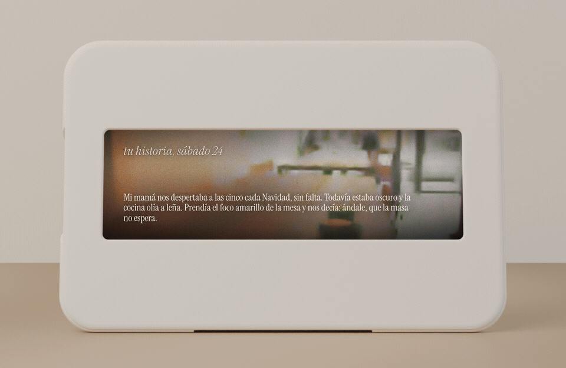
</p>

The Hearth is an Alexa Tablet 8 (2026) running our web app inside our own
Android kiosk app. It has no buttons. Margaret taps the screen to talk, and taps
again when she is done.

<p align="center">
  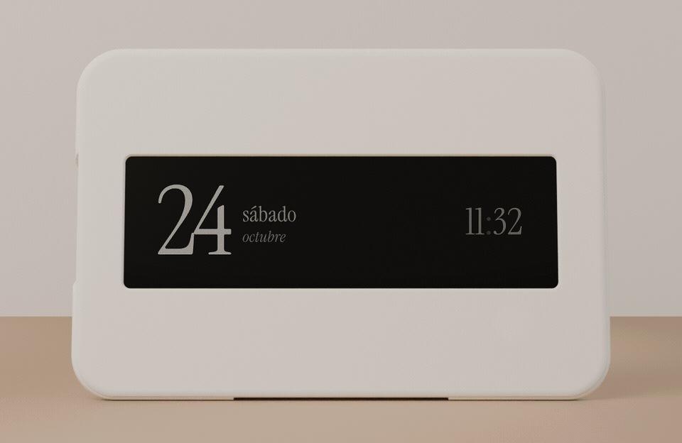
</p>

Most of the day it shows the date in a big serif numeral. When her
grandson has written back it says "Angel te escribió". While she talks it
says "te escucho" with a REC counter. Her stories play back as films whose
scenes change with her voice, with the Spanish line on screen.

<p align="center">
  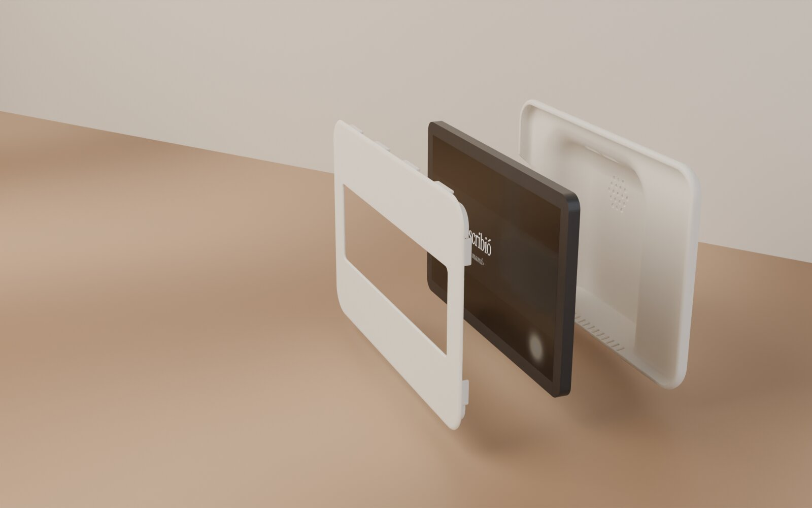
</p>

It lives in one of two frames. The simple one is an IKEA SANNAHED 25x25 shadow
box with a cream mat cut to a strip window. The other is a 3D printed case
drawn in the language of Modem's Dream Recorder: a front bezel and a back
shell, about 3.7 hours of printing.

<p align="center">
  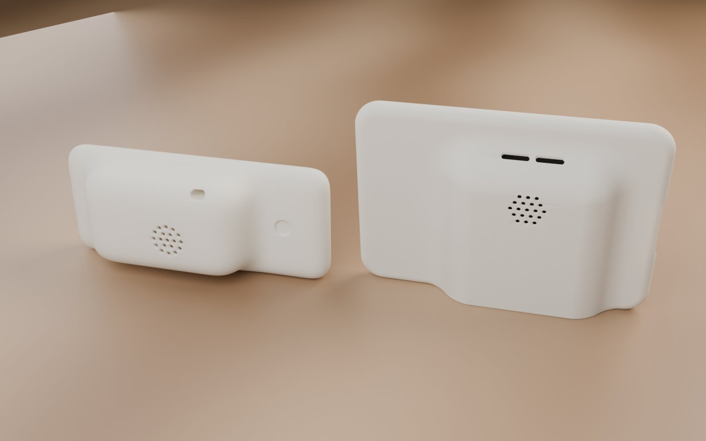
</p>

<p align="center">
  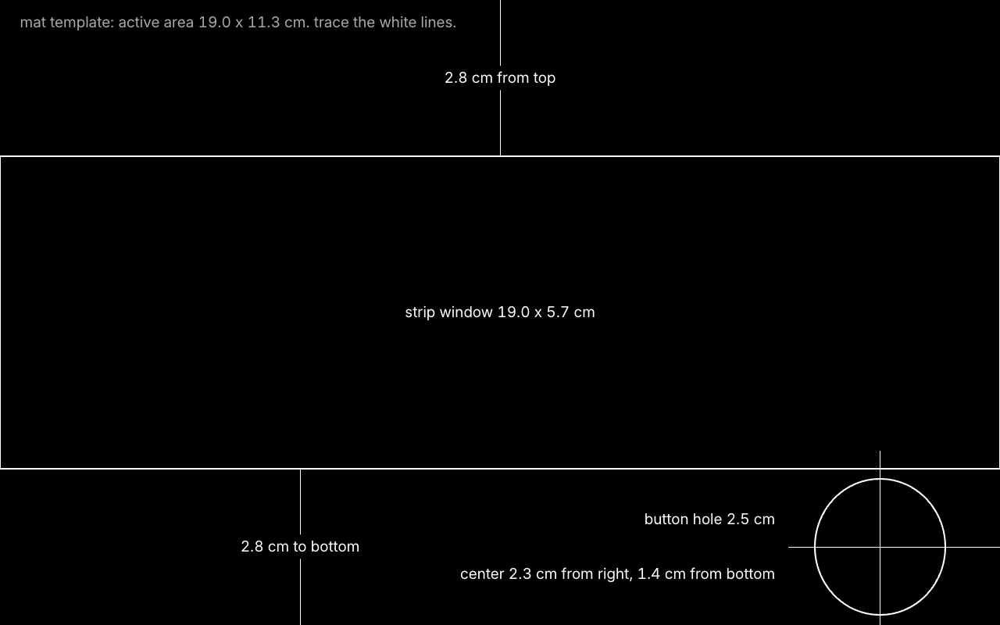
</p>

## The Almanac

<p align="center">
  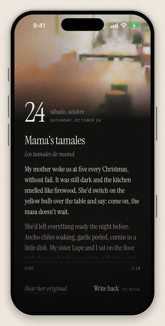
</p>

The Almanac is a SwiftUI app. It shows the week as a calendar, with an oxblood
ribbon on today. Each story opens as a film in five scenes that change as her
voice narrates, and the sentence being spoken is highlighted.

<p align="center">
  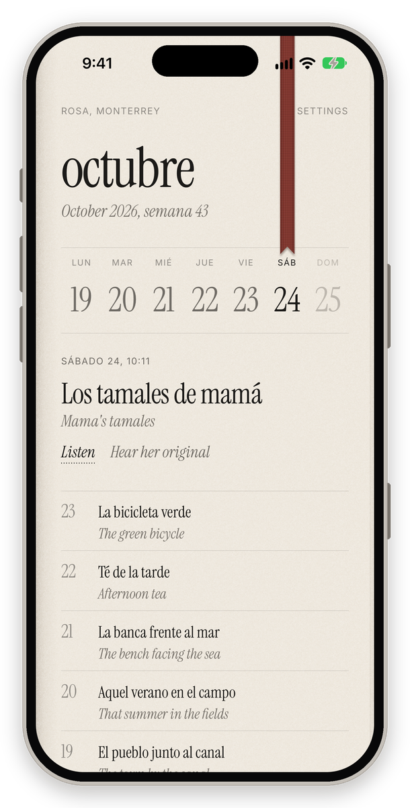
  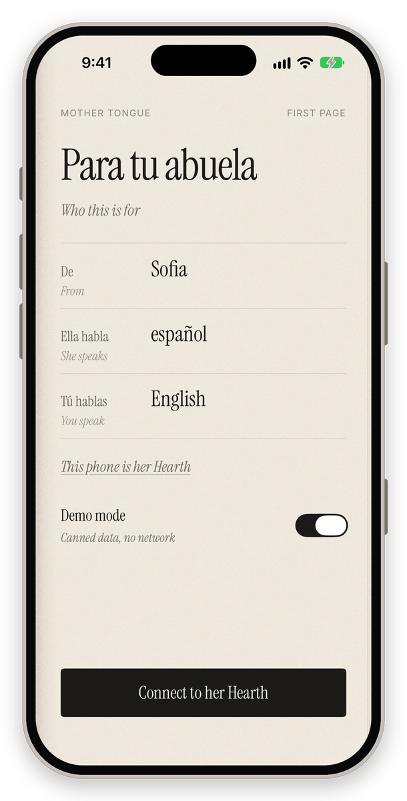
</p>

Hear her original plays her real voice, in Spanish, so the translation never
replaces her. Write back offers three questions to ask her, drawn from what she
just said. Hold to record. She hears the reply in Spanish, in her
grandson's own voice.

<p align="center">
  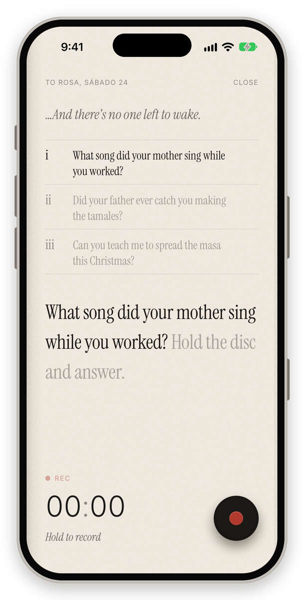
</p>

<p align="center">
  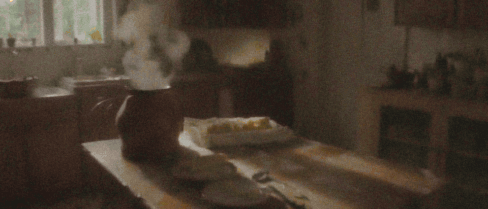
</p>

## How the AI fits together

| Step | Model | Where it runs |
| --- | --- | --- |
| Speech to text | ElevenLabs Scribe | Supabase edge function |
| Translation that keeps endearments, cultural notes, "ask her about" questions, and the story split into five beats with cinematic prompts | OpenAI GPT-6 Luna through the Codex CLI on a ChatGPT subscription (codex-relay) | Edge function and story worker |
| Voice, so each person is heard in their own voice in the other language | ElevenLabs Instant Voice Clone with eleven_multilingual_v2 | Edge function |
| Scenes, five clips per story | Luma ray-3.2 through the Luma Agents API | Story worker (Python, with an ffmpeg film grain chain adapted from Dream Recorder) |
| Data and realtime | Supabase Postgres, storage, realtime | Supabase |

The full flow is in [docs/ARCHITECTURE.md](docs/ARCHITECTURE.md), and the
shared data contract is [docs/CONTRACT.md](docs/CONTRACT.md).

## Privacy and consent

A voice is cloned only from a sample that person records themselves, and it is
used only inside their own family thread. The original audio is always one tap
away. Everyone filmed for the demo signed [docs/CONSENT.md](docs/CONSENT.md).

## Run it yourself

Each part has its own README with the detail. This is the short version. The
two-device run we show judges is in [docs/DEMO_SCRIPT.md](docs/DEMO_SCRIPT.md).

The backend, on a hosted Supabase project:

```sh
cd backend
supabase link --project-ref <project-ref>
supabase db push
supabase secrets set --env-file .env.secrets   # see backend/README.md
supabase functions deploy process-message enroll-voice make-story --no-verify-jwt
scripts/smoke.sh clip.m4a
```

The Hearth web app:

```sh
cd hearth-web
cp config.example.js config.local.js
python3 -m http.server 8000
open "http://localhost:8000/?demo=1"
netlify deploy --prod --dir . --site mothertongue-hearth
```

The story worker:

```sh
cd story-worker
python -m venv .venv && source .venv/bin/activate
pip install -r requirements.txt
cp .env.example .env
python main.py --luma-check
caffeinate -i python main.py
```

The iPhone app. Demo mode needs no backend.

```sh
brew install xcodegen
cd ios
cp Config/Secrets.example.xcconfig Config/Secrets.xcconfig
xcodegen generate
open MotherTongue.xcodeproj
```

The tablet:

```sh
cd fire-kiosk
./gradlew assembleDebug -PhearthUrl=https://mothertongue-hearth.netlify.app
scripts/setup-device.sh https://mothertongue-hearth.netlify.app
```

See [backend/README.md](backend/README.md),
[hearth-web/README.md](hearth-web/README.md),
[story-worker/README.md](story-worker/README.md) and
[fire-kiosk/README.md](fire-kiosk/README.md). The case files are
`hardware/cad/stl/front_bezel.stl` and `hardware/cad/stl/back_shell.stl`.

<p align="center">
  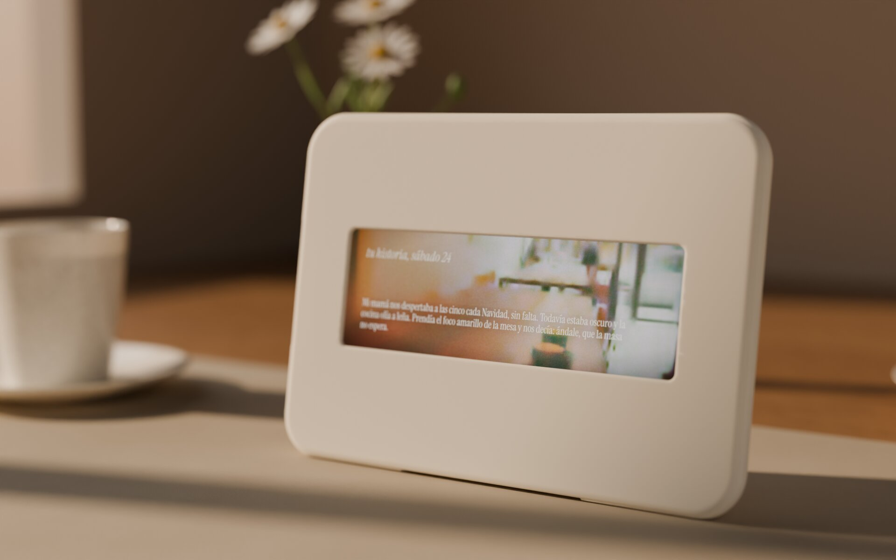
</p>

<p align="center">
  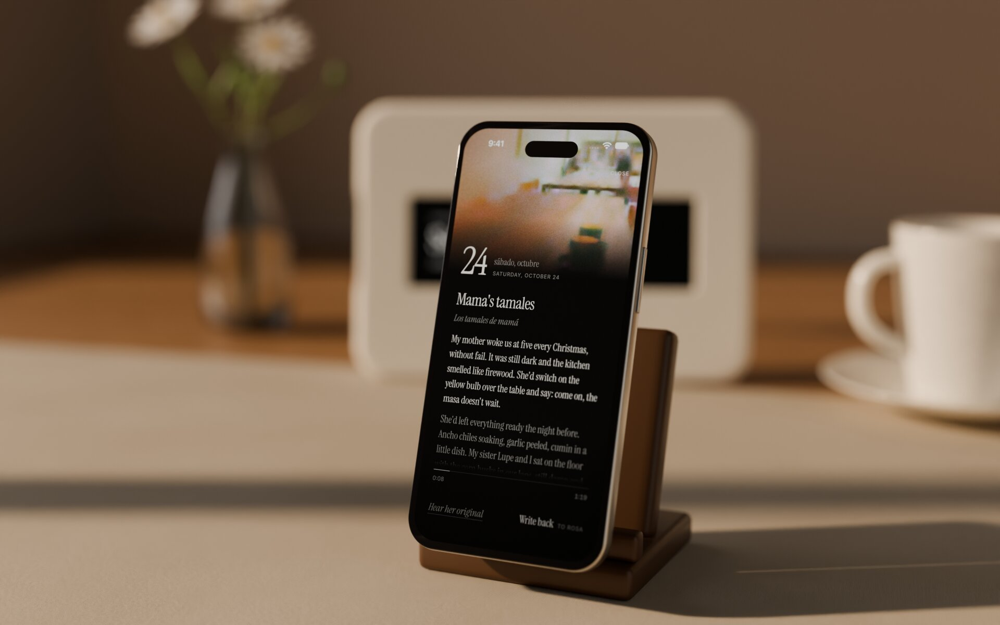
  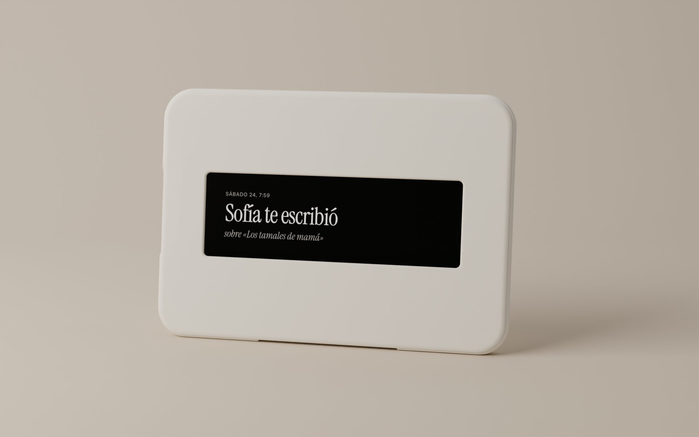
</p>

## How we built it

We built this with Claude Code working as a coordinator with parallel subagents.
We wrote a shared contract first ([docs/CONTRACT.md](docs/CONTRACT.md)) so the
backend, the Hearth, the iPhone app and the worker could be built at the same
time against the same tables. We checked every screen by screenshot before
accepting it. We explored the design as four variants and refined one
(`design/iterations/`), and modeled the case as signed distance fields and
rendered it in Blender. We approved every plan and read the changes.

## Credit

Built by [Angel Vega](https://github.com/advegaf) and
[Nethum](https://github.com/nethum529).

The look, the case language and the ffmpeg chain come from Modem's
[Dream Recorder](https://github.com/modem-works/dream-recorder), which is MIT.
The demo scene photos are from Lorem Picsum, under the Unsplash licence.
Instrument Serif and Inter are under the SIL Open Font License.

## Licence

MIT. See [LICENSE](LICENSE).
