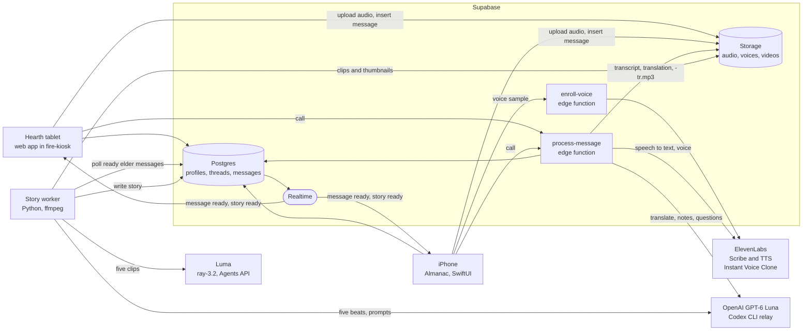

# Architecture

Two clients, one Supabase project, two edge functions and one worker. The
clients never talk to each other directly. They write rows and files to
Supabase and listen for changes on the same thread.

## One story, Hearth to iPhone

1. Rosa taps the Hearth. The web app records her voice as webm and shows
   "te escucho" with a REC counter.
2. She taps again. The Hearth uploads the clip to `audio/{thread_id}/{message_id}.webm`,
   inserts a `messages` row with `status = 'uploaded'`, and calls `process-message`.
3. `process-message` sets `processing`, sends the audio to ElevenLabs Scribe
   for a Spanish transcript, then asks GPT-6 Luna for an English translation
   that keeps her endearments, a few cultural notes, and three "ask her about"
   questions.
4. It speaks the translation with ElevenLabs `eleven_multilingual_v2` in Rosa's
   cloned voice, uploads `{message_id}-tr.mp3`, and sets the row to `ready`.
5. Realtime tells the iPhone. The story appears on today in the Almanac and
   can already be played as audio.
6. The story worker, polling every 5 seconds, claims the message by writing
   `story = {status: "generating"}`. It asks GPT-6 Luna to split the story into
   five beats, each with an English excerpt, the matching Spanish excerpt and a
   cinematic prompt that shares one world line.
7. It sends the five prompts to Luma `ray-3.2`, runs each clip through the
   film grain chain adapted from Dream Recorder, uploads the clips and
   thumbnails to `videos/`, and writes the five scenes with their start and end
   fractions into `story`.
8. Realtime tells both clients. The story now plays as a film on the iPhone and
   on the Hearth, the scene changing as the narration reaches each beat.

## One reply, iPhone to Hearth

1. Sofía taps Write back. The Almanac offers the three questions from step 3.
2. She holds to record and lets go. The app uploads `audio/{thread_id}/{message_id}.m4a`,
   inserts a `messages` row from her profile, and calls `process-message`.
3. Scribe transcribes her English, GPT-6 Luna translates it into Spanish, and
   ElevenLabs speaks it in Sofía's cloned voice.
4. The row turns `ready`. Realtime tells the Hearth, which shows "Sofía te escribió".
5. Rosa taps and hears the question in Spanish, in her granddaughter's voice.

Voices come from `enroll-voice`: each person records a short sample, the
iPhone app uploads it to `voices/{profile_id}.m4a` (the iPhone app is the
only client that calls `enroll-voice`), and the function creates an
ElevenLabs Instant Voice Clone and stores its id on the profile. Without a
clone, `process-message` falls back to a stock voice.

## Data contract

Tables, storage paths, the `story` JSON shape and the edge function requests
are defined in [CONTRACT.md](CONTRACT.md). Every client and the worker were
built against that file, so read it before changing any of them.
