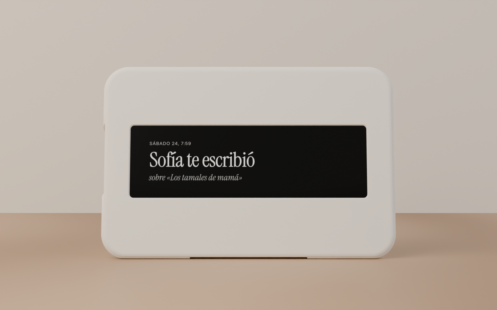
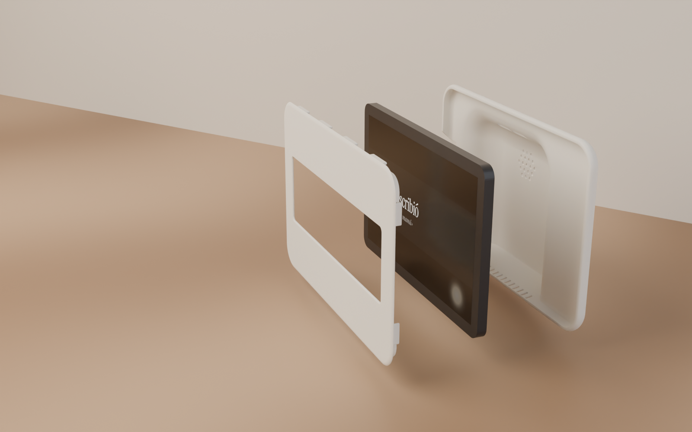
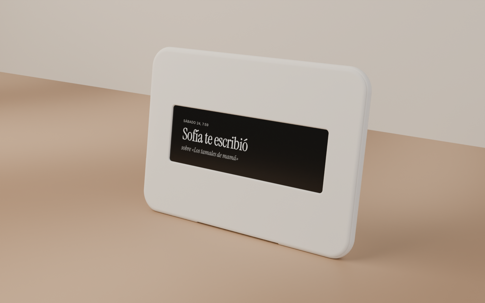
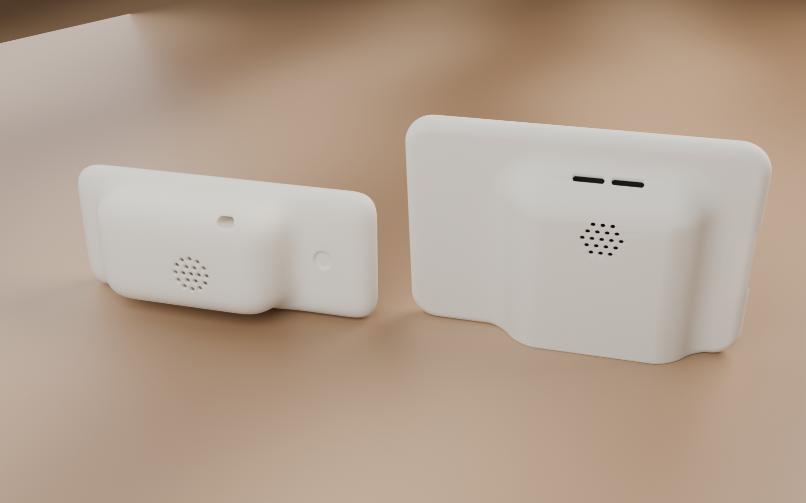

# Hearth hardware

> **Current build: no physical button.** `BUTTON = False` and `GLOW_BANDS = False` in `cad/hearth_v4_sdf.py`. Grandma taps the screen through the window, and the Hearth treats any tap on the strip as a press. Only two parts print: `front_bezel.stl` and `back_shell.stl` (110.8 cm3, about 3.7 h, about 4.1 h with supports). The button cap, copper tape, foam ring and stylus sections below are optional and apply only if you set `BUTTON = True` and rebuild.

The Hearth is an Alexa Tablet 8 (2026) in a two piece printed case that is meant to read as a sibling of Modem's [Dream Recorder](https://github.com/modem-works/dream-recorder) (MIT): a flat front bezel with a window, and a soft pillow shaped back with a raised hump, a 19 dot grid and two pill slots. A row of 13 slots in the bottom wall lets the tablet's own speakers out. There are no extra electronics. The window (about 184.1 x 56.8 mm) shows the middle 50% of the display height. The top and bottom quarters sit behind the solid bezel face. With `GLOW_BANDS = True` they sit behind a 1.0 mm skin instead and glow through it in a glow or translucent PLA. The tablet runs hearth-web inside the fire-kiosk app (`../fire-kiosk/`).

v5 is the current button-free build. The v4 renders still show the optional button cap:

Showcase renders (product shots of the Hearth and the iPhone app): `render/showcase-breakfast.png`, `showcase-playing.png`, `showcase-phone.png`, `showcase-studio.png`. Also: `render/hearth-v4-front.png`, `-side.png`, `-back.png`, `-exploded.png`, `-context.png`.

## Files

- `cad/hearth_v4_sdf.py` defines the bezel and shell as signed distance fields and meshes them with marching cubes. All dimensions are named constants at the top. The measure first block (tablet body, active area and offset, clearance) is the single source: `hearth_parts.py`, and through it `hearth_v4.py` and the render scripts, import those values from here. `BUTTON` and `GLOW_BANDS` switch the optional button hole and glow skins. It writes `cad/build/*_raw.stl`.
  `uv run --python python3 --with numpy --with scikit-image python cad/hearth_v4_sdf.py [voxel mm, default 0.35]` (about 5 s, under 1 GB RAM).
- `cad/hearth_v4.py` cleans those meshes (exact vertex merge, normals, decimate to 300k faces), builds the button cap from `cad/hearth_parts.py` when the button is on, writes `cad/stl/` and prints size, volume, manifold check and a print estimate. `blender -b -P cad/hearth_v4.py`
- `cad/hearth_parts.py` is the v2 parts library. v4 still uses its button cap, tablet and screen constants and helpers.
- `render/hearth_scene_v4.py` renders the print STLs in matte cream with the real Hearth screen (`docs/screens/hearth-web-v2-waiting.png`, override with `HEARTH_SCREEN`):
  `blender -b -P render/hearth_scene_v4.py -- <hero|front|side|back|exploded|vs-dr|context> [abs out.png] [samples]`
  `context` puts it on a counter in warm window light with an iPhone showing the family app.
- `render/hearth_showcase.py` renders the showcase shots:
  `blender -b -P render/hearth_showcase.py -- <breakfast|playing|phone|studio> [abs out.png] [samples] [res %]`
- `reference/` holds the Dream Recorder STLs we compare against. See `reference/README.md`. The STLs themselves are gitignored.
- `cad/stl/old/` holds retired parts: the button cap and the v2 parts (front plate, corner clips, stand feet). Older scripts and renders (`hearth_scene*.py`, `hearth-v2-*`, `hearth-v3-*`) are kept for reference.

## Parts to print

| STL | Qty | Size (mm) | Volume | Orientation |
|---|---|---|---|---|
| `front_bezel.stl` | 1 | 224.3 x 148.1 x 6.6 | 37.8 cm3 | face down, lugs up |
| `back_shell.stl` | 1 | 227.9 x 151.2 x 34.4 | 73.0 cm3 | open face down, hump up |

Both fit a 250 x 250 bed.

Print estimate: 110.8 cm3 in total. At 30 cm3/h (0.28 mm layers on a Bambu or MK4 class printer) that is about 3.7 h, about 4.1 h with the supports inside the shell. At the 22 cm3/h the Dream Recorder's own print works out to, it is about 5.0 h, about 5.6 h with supports. Trust the slicer over these numbers. To save time, print the bezel and the shell on two printers.

## Print settings

Matte cream PLA for the look in the renders. 0.4 mm nozzle, 0.28 mm layers, 2 walls, 15% infill.

- Bezel: face down on a textured PEI sheet for a matte face. No supports. The face edge and window are 45 degree chamfers, so the first layers do not overhang. If you print with `GLOW_BANDS = True` in a translucent PLA, set infill to 100% on this part so no honeycomb shows through the glow bands.
- Shell: open face down. Tree supports, build plate only, for the ceiling and the inside of the hump (the Dream Recorder back needs the same). The outside needs none: the front round starts at 37 degrees from vertical at the seam, the hump walls lean in at 30 degrees, and the vent channel in the bottom face ends in a 45 degree ramp.

## Buy

- Alexa Tablet 8 (2026).
- Matte cream PLA. One spool is plenty.
- Adhesive foam: 1 mm foam pads (or thin felt pads) for the tablet back, and foam tape if you build the SANNAHED mat version instead.
- A right angle USB-C cable. A straight plug fits the notch but sticks out of the side.
- No kiosk app to buy: the fire-kiosk app (`../fire-kiosk/`) replaces Fully Kiosk Browser.

Optional button build only:

- Capacitive stylus pack with rubber nibs that pull off.
- Copper foil tape with conductive adhesive, about 1/4 in (6 mm) wide.
- 1/8 in (3 mm) foam weatherstrip for the button ring.

## Assembly

1. Lay the bezel face down on a towel. Drop the tablet in screen down, port toward the notch side (left as seen from the front by default). The four L ribs at the corners locate it.
2. Stick four 1 mm foam pads on the tablet back, near the corners. They take up the 0.8 mm gap to the shell ceiling so the tablet cannot rattle.
3. Press the shell on. The lugs on the bezel slide inside the shell wall with 0.15 mm per side. If it is loose, a layer of tape on the lugs fixes it, or set `LUG_FIT` to 0.05 and reprint the bezel. If it is too tight, sand the lugs.
4. Set it on the counter. The bottom is one flat face tilted 9 degrees, so the case leans back on its own. Run the cable out through the notch. The speaker slots sit in a 1.5 mm channel in that face, open to the front, so the counter does not seal them. Keep the channel clear of cloths and placemats.
5. Open hearth-web with `?calibrate=1` and fit the strip to the window (`../hearth-web/README.md`).

### Optional: button cap (`BUTTON = True`)

1. Copper tape on the cap, in one continuous strip: start at the centre of the face groove, run out to the edge, down the side groove, fold under the head, pass through the gap in the guide sleeve, run down the outside of the post and fold into the socket. Wrap the nib's stem with a turn of tape so the conductive rubber touches the copper, then push the nib into the socket. Check continuity from face to nib with a multimeter if you have one.
2. Cut a foam ring (outer about 26 mm, inner about 21 mm) from the 3 mm foam and stick it on the bezel face inside the V groove ring, around the 20 mm hole. Stick the cap on top, post through the hole.
3. Check the gap: at rest the nib should sit about 1 mm above the glass, and a press should touch. Add or remove foam to tune it. No finger means no ground, so it should not trigger on its own.
4. Calibrate the button zone: open hearth-web with `?calibrate=1`, press the cap a few times, and save the zone it reports. The cap sits at `BTN_X` 64, `BTN_Y` -43, inside the bottom band. The cap was sized for the Fire HD 8 screen; recheck that its hole lands on the lit area of the Alexa Tablet 8 before printing.

## Measure first (before slicing)

Update the constants at the top of `cad/hearth_v4_sdf.py` (and the same names in `cad/hearth_parts.py` for the cap), rerun both scripts, then slice.

- [ ] Tablet body: `TAB_W`, `TAB_H`, `TAB_T`. Current values 208.94 x 132.64 x 7.95 mm for the Alexa Tablet 8 (2026). Check your unit with calipers, case off. `BACK_GAP` (0.8) is the space left for foam pads.
- [ ] Clearance `CLR` (0.6 per side). Drop it to 0.3 if the tablet rattles, raise it if your printer runs fat.
- [ ] Display active area: `ACT_W`, `ACT_H` and the offset `SCREEN_OFF_X`, `SCREEN_OFF_Y`. The current values (190.14 x 113.52, centred) are 1340 x 800 px at 179 ppi. Open a full white page and measure the lit area with a ruler, and its offset from the body centre (the bezels are rarely equal).
- [ ] Which short edge has the USB-C port in the orientation you want (`USB_SIDE`, default left as seen from the front) and where along the edge it is (`USB_Y`, `USB_W` 60 mm). Not checked against a real unit.
- [ ] The speaker position. The vents (`VENT_X` -40 to 40, `VENT_N` 13, `VENT_W`, `VENT_Z`) assume the speakers fire out of the bottom long edge in landscape, as on the Fire HD 8. Check which edge and where along it on the Alexa Tablet 8, and move `VENT_X` if needed (keep it inside the bottom lugs at `LUGS_BOTTOM_X`). The 19 dot grid (`SPK_X`, `SPK_Y`) is placed for looks on the hump. It is a grille, not a sound path.
- [ ] Optional button build: stylus nib protrusion (`NIB_PROTRUDE`, default 2.0), stem diameter (`SOCKET_D`, default 5.2) and foam thickness (`FOAM_T`, default 3.0).
- [ ] Printer bed is at least 235 x 165 mm.

## IKEA SANNAHED alternative

No printer? Put the tablet behind a cream mat board in an IKEA SANNAHED 25x25 shadow box frame instead. Open hearth-web with `?template=1` on the tablet, trace the strip window (about 19.0 x 5.7 cm), cut it, foam tape the tablet behind the mat and calibrate the strip. No button hole is needed. Steps are in `../hearth-web/README.md`.

## Open risks

- Active area offset is an estimate. If the window is off by a few mm, recalibrate the strip in hearth-web, but measure before printing.
- The USB-C edge and the speaker edge are guesses carried over from the Fire HD 8 layout. Check both on the real tablet before printing the shell.
- Lug fit is 0.15 mm per side by design and has not been test printed. Print a corner of the bezel and shell first if there is time.
- The shell is the long print. Its internal supports add time and leave marks inside, which nobody sees.
- Stability: the hump gives the base roughly 30 mm of depth across the middle 130 mm. The centre of mass sits about 18 mm behind the front edge, so it stands, but a hard push at the top can tip it backward. The vent channel lifts the middle 90 mm of the front edge off the counter, so the front contact is two pads outside it. Still stable in the renders.
- Optional button build: the copper plunger is untested on this tablet, and the cap stands 9 mm proud of the face. Fallbacks are a Bluetooth shutter remote that sends Enter, or the tap on the strip the current build already uses.
